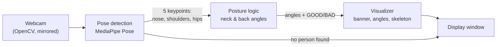
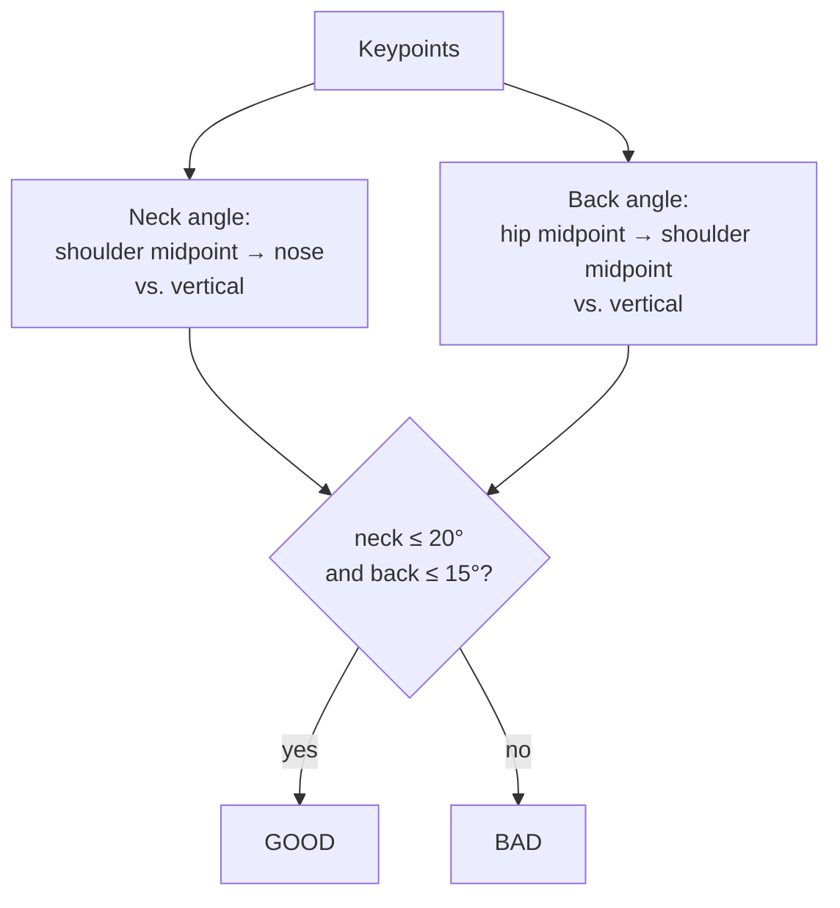

# Ergonomic Pose Monitor

A real-time webcam app that watches how you sit, measures your neck and back angles, and tells you instantly whether your posture is good or bad, for anyone who spends long hours at a desk.

<!-- TODO: add demo -->


## Tech Stack

Python · MediaPipe Pose · OpenCV · NumPy · pytest

## Features

- **Live posture feedback**: a green **GOOD POSTURE** or red **BAD POSTURE** banner updates on every frame.
- **Angle readouts**: shows the current neck and back angles so you can see how far off you are.
- **Body overlay**: draws the tracked nose, shoulders, and hips plus a simple skeleton on the video.
- **Lightweight and explainable**: no model training; posture is judged with two angle rules you can read and tune.
- **Runs locally** on a regular laptop webcam, with an FPS counter.

## Architecture



Each frame flows through three small modules: `pose/` finds body landmarks, `logic/` turns them into angles and a verdict, and `ui/` draws the result. `main.py` wires them into a capture loop.

**How posture is judged:**



## Getting Started

**Prerequisites:** Python 3.10–3.12 (verified on 3.11; the pinned MediaPipe version has no Python 3.13 build) and a webcam.

```bash
python -m venv .venv
source .venv/bin/activate          # Windows: .venv\Scripts\activate
pip install -r requirements.txt

python main.py                     # opens the webcam window; press q to quit
```

`python main.py` needs a webcam and a display, so it hasn't been verified in a headless environment.

**Tests** (no camera needed):

```bash
pip install pytest
pytest                             # 12 tests: angle math, thresholds, pose detector, overlay
```

## Technical Decisions & Challenges

- **Rules instead of a trained classifier.** Two geometric angles with fixed thresholds (20° neck, 15° back) need no labelled data, run in real time, and make every verdict easy to explain.
- **Angles measured against a vertical reference.** Comparing body segments to "straight up" in image coordinates keeps the math simple and independent of where you sit in the frame.
- **Pinned MediaPipe version.** Newer MediaPipe releases removed the `mp.solutions.pose` API this project uses, so `requirements.txt` pins 0.10.14 to keep installs working.
- **Small, separate modules.** Detection, posture logic, and drawing live in their own files, so the logic can be unit-tested without a camera.

## Limitations

- **Front view only.** Posture is judged from a single front-facing camera in 2D, so it mainly catches sideways tilt and lean; leaning toward or away from the camera (forward head, rounded back) is hard to see from this angle.
- **Fixed rules.** The two angle thresholds are hand-picked, not learned from data, so they may not suit every body type or seating setup.

## Next Steps

- Evaluate posture from multiple angles: add a side-view camera, combine several cameras, or use MediaPipe's 3D landmarks.
- Train a classifier on labelled posture examples to replace or complement the fixed angle rules.
- Smooth angles over several frames to avoid flicker between GOOD and BAD.
- Add a quick calibration step that learns each user's neutral posture.
- Alert after sustained bad posture (sound or desktop notification) and log posture over time.

## Credits

Built as a team project (3 members).

## License

[MIT](LICENSE)
